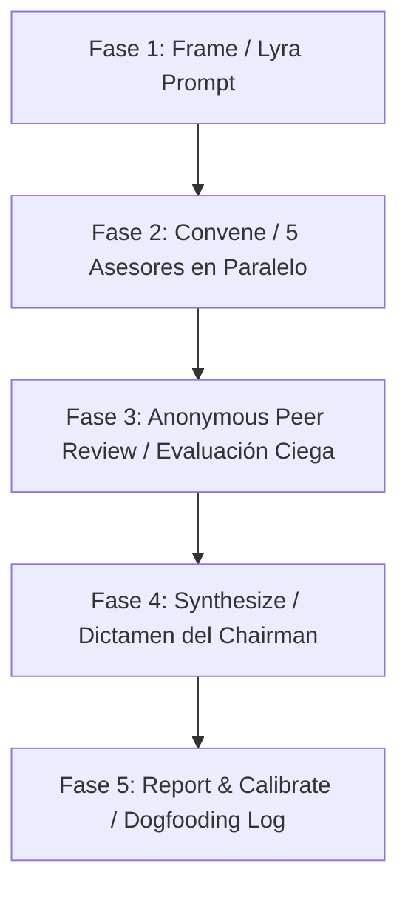

# 🏛️ Manifiesto del Consejo Agéntico Determinista de ACCET
**Código de Norma:** STD-AGT-COUNCIL-001  
**Versión:** 1.0.0  
**Fecha de Entrada en Vigor:** 21 de Septiembre, 2026  
**Autoría / Origen:** Adaptación formal de la metodología *LLM Council* (Andrej Karpathy) al ecosistema soberano ACCET QMS, Antigravity CLI (`agy`) y OmniRoute.

---

## 1. Misión y Filosofía
Las decisiones complejas de arquitectura, gestión de calidad (QMS), prospección comercial B2B y despliegue agéntico sufren comúnmente de tres patologías cuando son abordadas por un único modelo o un chat secuencial:
1. **Complacencia por adulación (Sycophancy):** El modelo tiende a validar las premisas y deseos del usuario en lugar de cuestionarlas.
2. **Ceguera de punto único (Monoculture Bias):** Una sola perspectiva cognitiva omite riesgos operacionales o expansiones de mercado no evidentes.
3. **Parálisis por consenso tibio:** Los comités humanos o deliberaciones no estructuradas suelen diluir las tensiones en compromisos blandos que aumentan la deuda técnica.

El **Consejo Agéntico Determinista** resuelve esto implementando una asamblea de deliberación ciega y estructurada, compuesta por **cinco lentes cognitivos ortogonales** y una **presidencia sintetizadora**.

---

## 2. Los 6 Roles Canónicos del Consejo

| Rol / Skill | Identidad Cognitiva | Mandato Principal | Límite Extensión |
| :--- | :--- | :--- | :--- |
| **`the-contrarian`** | El Abogado del Diablo Metodológico | Encontrar el fallo fatal, auditar suposiciones peligrosas y modelar el peor escenario realista. | 150-300 palabras |
| **`first-principles-thinker`** | El Físico / Reduccionista | Reducir el problema a verdades físicas y matemáticas irrefutables; eliminar dogma de industria. | 150-300 palabras |
| **`the-expansionist`** | El Estratega 10x | Explorar economías de escala, opcionalidad asimétrica y efectos de red; pensar en órdenes de magnitud mayores. | 150-300 palabras |
| **`the-outsider`** | El Forastero Inocente | Traer analogías de industrias no relacionadas, desafiar el vocabulario heredado y hacer preguntas ingenuas cruciales. | 150-300 palabras |
| **`the-executor`** | El Operador Pragmático | Diseñar el plan táctico para el lunes a las 8:00 AM, auditar cuellos de botella de infraestructura y coste real. | 150-300 palabras |
| **`council-chairman`** | El Árbitro Ejecutivo | Sintetizar los consensos, arbitrar choques irreconciliables, identificar puntos ciegos y dictar la Primera Acción. | 300-500 palabras |

---

## 3. Protocolo de Ejecución en 5 Fases

### Fase 1: Framing (Encuadre determinista)
- Toda entrada pasa mandatoriamente por el protocolo de meta-prompting 4-D (`STD-AGT-LYRA-001`).
- Se genera un archivo de prompt en `router-dev/prompts/` que descompone el contexto, objetivo, restricciones duras (cero costo, soberanía local) y entregables.

### Fase 2: Convene (Convocatoria Paralela Ciega)
- Los 5 asesores son invocados en paralelo de forma totalmente independiente.
- Ningún asesor conoce la respuesta de sus pares en esta fase.
- La ejecución se apoya en el motor `agy -p` de Antigravity CLI o los endpoints libres de OmniRoute (`http://localhost:20128`).

### Fase 3: Anonymous Peer Review (Evaluación Cruzada Ciega)
- Las 5 respuestas se anonimizan como `Asesor A`, `Asesor B`, `Asesor C`, `Asesor D` y `Asesor E`.
- Se entrega el bloque completo a cada modelo para evaluar:
  - ¿Cuál es el argumento más sólido y por qué?
  - ¿Cuál es la mayor debilidad o error conceptual en el conjunto?
  - ¿Qué punto ciego persiste ignorado por los cinco?

### Fase 4: Synthesize (Presidencia y Dictamen)
- El `council-chairman` recibe el problema original, las 5 posturas iniciales y las evaluaciones cruzadas.
- Emite un dictamen sin compromisos diplomáticos: Consensos, Choques Resueltos, Puntos Ciegos, Decisión Estratégica (Proceder / Pivotar / Abortar) y La Primera Acción Innegociable.

### Fase 5: Report & Dogfooding (Reporte y Calibración Continua)
- Se compila un reporte HTML autónomo e interactivo (`council_report.html`) y un archivo Markdown en `router-dev/sessions/`.
- Cada asesor actualiza su sección `## Dogfooding & Continuous Calibration Log` en su respectivo `SKILL.md` registrando los sesgos corregidos para futuras deliberaciones.

---

## 4. Reglas Innegociables del Sistema
1. **Cero Costo de API:** Ninguna deliberación puede invocar APIs de pago de OpenAI o Anthropic. Todo el cómputo debe ejecutarse localmente, vía sesión de Google Cloud CLI autenticada (`agy`) o endpoints gratuitos enrutados por OmniRoute.
2. **Router Inter-Agente Mandatorio:** La comunicación entre fases o subagentes debe pasar por prompts estructurados y auditables; queda prohibido el paso informal de contexto sin trazabilidad en disco.
3. **Aislamiento de Habilidades:** Cada asesor reside en su propia carpeta `skills/<nombre_skill>/SKILL.md`, permitiendo a Antigravity, Claude Desktop o cualquier entorno agentic invocar asesores específicos según demanda.
4. **SemVer y Versionado QMS:** Toda evolución de los prompts o skills debe ser registrada con `version_manager.py` en el QMS de ACCET.
